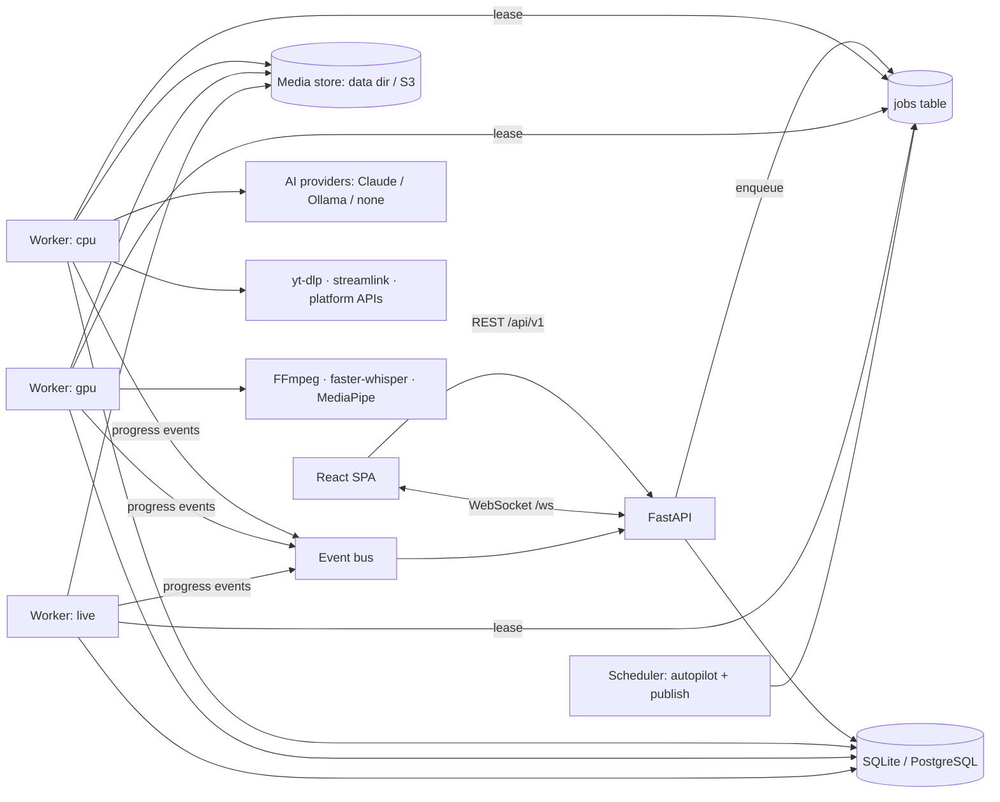
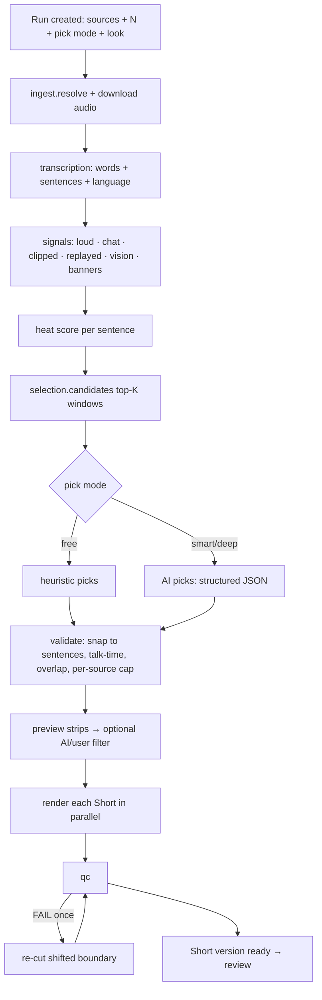

# 04 — Architecture & System Design

## 1. High-level



**Processes**
- `api` — HTTP + WebSocket, no heavy work, never blocks.
- `worker` — N processes; each declares capabilities (`cpu`, `gpu`, `net`, `live`) and leases only jobs it can run. GPU jobs are limited to 1–2 concurrently to protect VRAM.
- `scheduler` — fires autopilot runs and scheduled publishes into the queue.
- Local mode runs all three under one launcher (supervisor); server mode runs them as separate containers.

**Event bus:** in local mode an in-process/SQLite-notify channel; in server mode PostgreSQL `LISTEN/NOTIFY` (or Redis pub/sub if scaled out). Workers publish `{job_id, step, pct, message}`; API fans out to WebSocket subscribers.

## 2. Backend module layout (Python package `clipforge`)

```
clipforge/
  api/            routers (v1), websocket, deps, auth, error handlers
  core/           config, logging, security (secret encryption), paths, system profile
  db/             models, session, repositories, alembic/
  jobs/           queue (enqueue/lease/heartbeat/retry), worker runtime, job registry
  pipeline/       pure functions per step, no web/DB imports:
    ingest/       url resolver, downloader, metadata, discovery (rss/search/category)
    transcription/ whisper runner, sentence builder, language detect
    signals/      loudness, chat (replay + live readers), clips, replay heat, vision moments, ocr banners, heat score
    selection/    windows, candidates, heuristics (no-AI), callbacks, validation, ai_picker
    render/       reframe/, captions/ (ASS builder + style registry), formats/, audiofx/ (sfx synth, music bed, ducking), voice, translate, compose (ffmpeg graph builder), encode
    qc/           checks + scoring
    preview/      peek strips, contact sheets, covers
  ai/             provider interface, claude provider, ollama provider, none provider, prompts/, schemas
  services/       orchestration used by API + jobs (runs, shorts, edits, schedule, live, publish, insights)
  integrations/   youtube (upload, stats, oauth), twitch, kick, generic publisher interface
  live/           recorder (rolling buffer), chat spike detector, hunt
  scheduler/      autopilot, publish timer
```

Rule: `pipeline/` modules are pure (inputs → outputs + files) so they're unit-testable without DB; `services/` wire them to DB and jobs.

## 3. Processing pipeline (a "Run")



Each box is a **job step**; a Run is a parent job with child jobs (one per source for analysis, one per Short for render). Steps are idempotent and cache their outputs by content hash, so a retry resumes rather than restarts.

### Render step internals (one Short)

1. Download only `[start−pad, end+pad]` at best quality (yt-dlp `--download-sections`).
2. Speech map from word timings → keep-spans (drop gaps > X s, fillers) → edit decision list (EDL).
3. Reframe plan: shot cuts → per shot detect faces/persons/cam box → choose layout → crop/track keyframes (smoothed).
4. Caption track: words remapped through the EDL → ASS file (style registry) → keyword colouring → avoid-face placement.
5. Overlays: hook, watermark, progress bar, end card, format cards, meme effects.
6. Audio: denoise → ducking (voice/music) → SFX → loudnorm 2-pass to −14 LUFS.
7. One FFmpeg filter graph builds the final MP4 (NVENC if available); extra aspects; cover JPG; post text.
8. QC.

## 4. API design (REST `/api/v1`, JSON, OpenAPI-documented)

| Resource | Endpoints |
|---|---|
| System | `GET /health`, `GET /system` (GPU, RAM, disk, ffmpeg, versions), `GET /system/doctor` |
| Settings | `GET/PATCH /settings`, `GET /settings/ai/providers`, `POST /settings/ai/test` |
| Creators | `GET/POST /creators`, `PATCH/DELETE /creators/{id}`, `GET /creators/{id}/live`, `GET /creators/{id}/past` |
| Sources | `POST /sources` (url or upload), `GET /sources`, `GET /sources/{id}` (+ transcript, signals, timeline), `DELETE` |
| Runs | `POST /runs` (sources, n, pick_mode, look, dry_run), `GET /runs`, `GET /runs/{id}`, `POST /runs/{id}/cancel` |
| Candidates / picks | `GET /runs/{id}/candidates`, `GET/PUT /runs/{id}/picks`, `POST /runs/{id}/render` |
| Shorts | `GET /shorts` (filters: status, run, creator, qc), `GET /shorts/{id}`, `PATCH /shorts/{id}` (title, hook, hashtags…), `POST /shorts/{id}/review` (approve/reject), `POST /shorts/bulk` |
| Versions | `GET /shorts/{id}/versions`, `POST /shorts/{id}/rerender` (look/format/meme…), `POST /shorts/{id}/edit` (manual EDL/caption edits), `POST /shorts/{id}/ai-edit` (instruction), `POST /shorts/{id}/voice` (upload), `POST /shorts/{id}/versions/{v}/activate` |
| Media | `GET /media/{asset_id}` (range requests for video), `GET /shorts/{id}/export` (zip) |
| Brand / themes | `GET/PUT /brand`, `GET /themes`, `GET /caption-styles` (with preview images) |
| Schedule | `GET/POST /schedule`, `POST /schedule/plan` (auto spread), `PATCH/DELETE /schedule/{id}`, `GET /schedule.csv` |
| Publishing | `GET /integrations`, `POST /integrations/{provider}/connect` (OAuth start/key), `POST /integrations/{id}/test`, `POST /publish/{schedule_id}/preview`, `POST /publish/{schedule_id}/confirm` |
| Live | `POST /live/sessions`, `GET /live/sessions`, `POST /live/sessions/{id}/stop`, `POST /live/sessions/{id}/buffer`, `GET /live/hunt` |
| Autopilot | `GET/PUT /autopilot`, `POST /autopilot/preview` |
| Insights | `GET /insights/channel`, `POST /insights/diagnose/{short_id}`, `POST /insights/learn` |
| Jobs | `GET /jobs`, `GET /jobs/{id}` (+log), `POST /jobs/{id}/cancel`, `POST /jobs/{id}/retry` |

**WebSocket `/ws`** messages: `job.progress`, `job.done`, `job.failed`, `short.created`, `short.updated`, `live.rate`, `live.spike`, `run.status`.

Conventions: cursor pagination, `ETag` on settings, RFC 7807 problem+json errors, idempotency keys on POSTs that start jobs, every job-starting endpoint supports `dry_run=true` (returns the plan, writes nothing) — this replaces the reference's "show command" feature.

## 5. Cross-cutting concerns

- **Security:** local mode binds to 127.0.0.1 only, random session token in the launcher URL; server mode has auth (argon2 password + sessions, optional OIDC). Secrets encrypted at rest (Fernet with `CF_SECRET_KEY`). AI prompts treat transcripts/chat as untrusted data (delimited, never instructions); AI outputs are schema-validated before use. Subprocess calls use arg lists (no shell). Upload size/type limits; path traversal guards on media serving.
- **Observability:** structlog JSON logs with `job_id`/`run_id`, per-step timings, AI token usage & cost per job, `/system/doctor`.
- **Config:** pydantic-settings layered: defaults → `.env` → DB settings (UI-editable).
- **Extensibility registries:** caption styles, layouts, formats, meme moods, AI providers, publishers, signal extractors — each is a registry entry, so adding one is a single module.

Architecture Decision Records live in `docs/adr/` (one per decision above).
