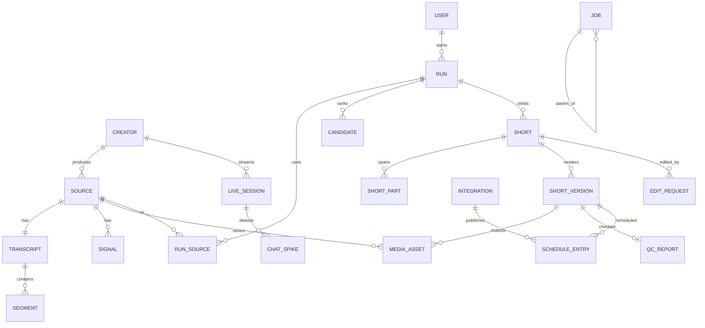

# 05 — Database Design

Relational schema (29 tables, implemented in Phase 1 migration `0001`), SQLAlchemy 2 models, Alembic migrations. Same schema on SQLite (local) and PostgreSQL (server). IDs are UUIDv7 (time-sortable). All tables have `created_at`, `updated_at`. JSON columns use `JSON` (SQLite) / `JSONB` (Postgres). Large data (word timings, frames, media) live on disk/object storage; DB stores paths + hashes.

## 1. ER overview



## 2. Tables

### Identity & settings
| Table | Key columns |
|---|---|
| `users` | id, email (unique), password_hash, role (`owner`/`editor`/`viewer`), locale, is_active — *one implicit owner row in local mode* |
| `settings` | key (PK), value JSON, updated_by — app-wide settings (AI provider/model/effort, pick mode, live thresholds, workers, paths, defaults) |
| `integrations` | id, provider (`anthropic`,`ollama`,`youtube`,`scheduler_x`…), label, secret_enc (bytea/blob), config JSON, status, last_tested_at |
| `brand_profiles` | id, name, is_default, watermark (json: type, path/text, pos, opacity, size), progress_bar bool, endcard_text, theme_id, default_style, default_layout, music_default, fonts JSON |
| `themes` | id, name, palette JSON (hook bg/fg, caption colours, keyword colour), font, builtin bool |

### Creators & sources
| Table | Key columns |
|---|---|
| `creators` | id, platform (`twitch`,`youtube`,`kick`,…), handle, display_name, language, enabled, clip_policy (`allowed`/`ask`/`denied`/`unknown`), policy_note, avatar_url — UNIQUE(platform, handle) |
| `discovery_rules` | id, kind (`rss`,`search`,`category`), query, keyword_regex, language, max_duration_s, enabled |
| `sources` | id, creator_id?, platform, external_id, url, title, channel_name, duration_s, published_at, language, window_start_s, window_end_s, status (`new`,`downloading`,`analyzing`,`ready`,`failed`,`skipped`), skip_reason, meta JSON — UNIQUE(platform, external_id) |
| `media_assets` | id, owner_type (`source`/`short_version`/`live_session`), owner_id, kind (`audio`,`video`,`segment`,`proxy`,`mp4`,`cover`,`aspect_4x5`,`aspect_1x1`,`caption_ass`,`peek`,`sheet`,`voice`), storage (`local`/`s3`), path, bytes, sha256, duration_s, width, height, codec |

### Analysis
| Table | Key columns |
|---|---|
| `transcripts` | id, source_id (unique), model, device, language, language_prob, words_path (JSON file of word timings), word_count, processing_s |
| `segments` | id, transcript_id, idx, start_s, end_s, text, heat (0–100), tags JSON (`[{type:"LOUD",value:12}, {type:"CHAT",x:4,top:"KEKW"}…]`) — INDEX(transcript_id, start_s); FTS index on text (SQLite FTS5 / Postgres tsvector) |
| `signals` | id, source_id, type (`loud`,`chat_rate`,`chat_spike`,`clip`,`replay`,`moment`,`banner`,`cut`,`laugh`), start_s, end_s, score, label, meta JSON — INDEX(source_id, type, start_s) |
| `used_ranges` | id, source_id, start_s, end_s, short_id — prevents overlap/reuse |

### Runs, selection, shorts
| Table | Key columns |
|---|---|
| `runs` | id, user_id, trigger (`manual`,`autopilot`,`live`), params JSON (n, pick_mode, look, sources, filters), status, ai_provider, ai_model, ai_usage JSON (tokens, cost), started_at, finished_at, error |
| `run_sources` | run_id, source_id (PK pair) |
| `candidates` | id, run_id, source_id, start_s, end_s, score, tags JSON, head_text, tail_text, rank |
| `shorts` | id, run_id, source_id, format (`moment`,`callback`,`compilation`,`escalation`,`thenvsnow`,`reveal`,`chat`,`waitforit`), hook, title, hashtags (array), keywords (array), credit, score, ai_reason, status (`picked`,`rendering`,`review`,`approved`,`rejected`,`scheduled`,`published`,`failed`,`dropped`), reject_reason, active_version_id |
| `short_parts` | id, short_id, idx, start_s, end_s, label |
| `short_versions` | id, short_id, version_no, origin (`render`,`rerender`,`manual_edit`,`ai_edit`,`voice`,`recut`), settings JSON (style, layout, theme, position, meme, music, lang, watermark, aspects, effects…), edl JSON (kept spans), caption_overrides JSON, crop_plan_path, render_ms, status — UNIQUE(short_id, version_no) |
| `qc_reports` | id, short_version_id (unique), verdict (`pass`,`warn`,`fail`), checks JSON (duration, lufs, black, freeze, card, coverage, face, first/last frame), reasons array |
| `edit_requests` | id, short_id, base_version_id, kind (`ai`,`manual`), instruction, plan JSON (validated tool calls), result_version_id, status, error |

### Scheduling & publishing
| Table | Key columns |
|---|---|
| `schedule_entries` | id, short_version_id, integration_id?, platform, scheduled_at_utc, timezone, caption_text, status (`planned`,`approved`,`sending`,`sent`,`failed`,`cancelled`), external_post_id, external_url, error, confirmed_by, confirmed_at |
| `autopilot_configs` | id, enabled, days (array), time_local, timezone, params JSON, last_run_id, next_run_at |

### Live
| Table | Key columns |
|---|---|
| `live_sessions` | id, creator_id, url, platform, status (`waiting`,`recording`,`stopped`,`failed`), started_at, ended_at, buffer_dir, ratio, min_rate, baseline_rate |
| `chat_spikes` | id, live_session_id, t_utc, rate, ratio, top_lines JSON, clip_asset_id, candidate_id |

### Insights
| Table | Key columns |
|---|---|
| `channel_insights` | id, channel_handle, fetched_at, stats JSON, learned_rules JSON |
| `post_metrics` | id, schedule_entry_id, views, avg_view_pct, likes, comments, fetched_at |

### Jobs
| Table | Key columns |
|---|---|
| `jobs` | id, parent_id, run_id?, type (`ingest`,`transcribe`,`signals`,`select`,`preview`,`render`,`qc`,`rerender`,`ai_edit`,`live_record`,`publish`,`learn`…), payload JSON, required_caps (array), priority, status (`queued`,`leased`,`running`,`succeeded`,`failed`,`cancelled`), attempts, max_attempts, lease_owner, lease_until, heartbeat_at, progress (0–100), step, result JSON, error, log_path, cache_key — INDEX(status, priority, created_at) |
| `audit_log` | id, user_id, action, entity, entity_id, data JSON, at |

## 3. Storage layout (media)

```
<CF_DATA_DIR>/
  sources/<source_id>/audio.m4a, words.json, segments/…, proxy_360p.mp4
  renders/<short_id>/v<n>/short.mp4, cover.jpg, short_4x5.mp4, captions.ass, plan.json
  previews/<run_id>/<short_id>.jpg, sheet.jpg
  live/<session_id>/seg_XXXX.ts (rolling), clips/
  cache/<sha256>/…            content-addressed intermediates
  models/ whisper/, mediapipe/, ocr/, translate/
  logs/<job_id>.log
```

Server mode: same keys in S3-compatible storage; local scratch on the worker for FFmpeg.

## 4. Data management

- **Retention policies** (settings): delete source video after N days, keep audio+transcript; purge rejected versions after N days; cache LRU by size cap.
- **Integrity:** sha256 for assets; foreign keys ON (SQLite `PRAGMA foreign_keys=ON`); soft-delete for shorts.
- **Backups:** SQLite online backup API nightly to `backups/`; Postgres `pg_dump` cron in server mode.
- **Migrations:** Alembic, forward-only in production, every migration tested on both engines in CI.
