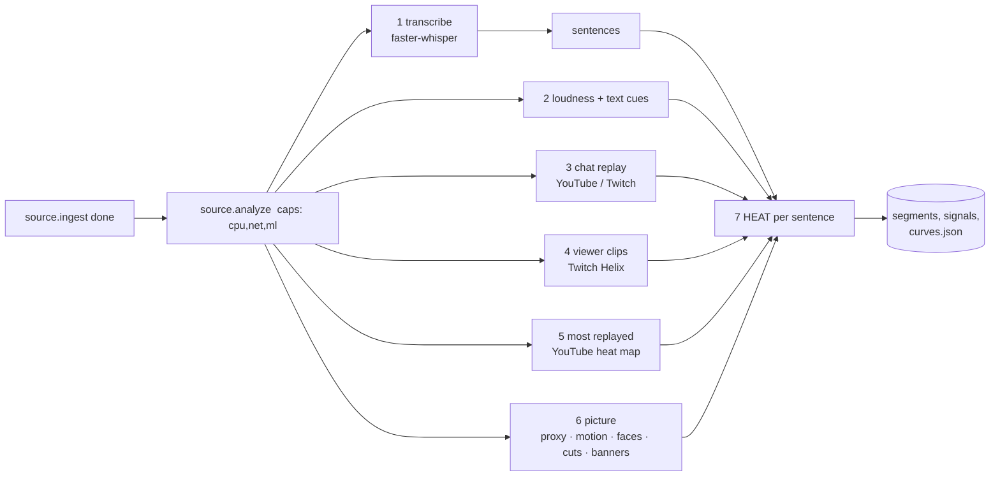

# Pipeline: Transcription & Signals (Phase 3)

After ingestion, every source is analysed by the `source.analyze` job: a word-level transcript, a set of **signals** (time ranges that hint at a good moment) and a **HEAT** score (0-100) for every sentence. Phase 4 picks moments from this.

## Flow

Only transcription is mandatory. Any other step that fails becomes a **warning** on the source (shown on the source page); the source still becomes `ready`. Re-running analysis reuses the transcript when the audio did not change (cache key: audio SHA-256 + window offset).

**Times:** everything stored is full-video seconds (audio time + window start).

## Steps

| Step | Module | Method | Output |
|---|---|---|---|
| Transcribe | `pipeline/transcription/whisper.py` | faster-whisper, word timestamps, Silero VAD, `condition_on_previous_text=False` (no repetition loops). GPU float16 `small`; CPU int8 `base`; automatic CPU fallback if CUDA fails. Model downloads once to `data/models/whisper` | `words.json`, `transcripts` row |
| Sentences | `pipeline/transcription/sentences.py` | split on . ? ! (incl. CJK), pauses > 0.6 s, > 20 words or > 15 s | `segments` rows |
| Loudness | `pipeline/signals/audio.py` | RMS dB per 0.5 s vs rolling 60 s median; ≥ +8 dB for ≥ 1 s | `loud` signals, loudness curve |
| Text cues | `pipeline/signals/text_cues.py` | laughter ("ha ha", "(laughs)", lol), reaction words, shouting | `laugh`, `moment` |
| Chat | `pipeline/signals/chat.py` | yt-dlp `live_chat` / `rechat` files; bots, !commands, links removed; 10 s bins vs rolling 5 min median; ≥ 3× and ≥ 15 msg/min; moved 8 s earlier (chat reacts late); top phrases/emotes | `chat_spike` (+ rate curve) |
| Viewer clips | `pipeline/signals/clips.py` | Twitch Helix with **your own** app credentials (`CF_TWITCH_CLIENT_ID/SECRET`); clips of this VOD with `vod_offset`; score = log10(views)/4 | `clip` |
| Most replayed | `pipeline/signals/replay.py` | yt-dlp `heatmap`; runs ≥ 60 % of the peak | `replay` (+ curve) |
| Picture | `pipeline/signals/vision.py` | 360p 4 fps proxy; motion = frame difference; **action** (≥ 2.5× rolling baseline, ≥ 3 s), **impact** (sudden jump); MediaPipe FaceLandmarker blendshapes (jaw open, eyes wide, smile, brows) → **reaction**; PySceneDetect **cuts** | `moment`, `cut`, motion curve |
| Banners (opt-in) | `pipeline/signals/banners.py` | RapidOCR on the centre band once per second, skipping unchanged frames; word list configurable | `banner` |
| HEAT | `pipeline/signals/heat.py` | weighted max per signal type within ±2 s of the sentence; weights re-normalised over the types available for this source; ×1.25 when ≥ 2 strong signals agree | `segments.heat`, `segments.tags` |

HEAT weights: loud 0.25 · chat 0.25 · clip 0.15 · replay 0.15 · moment 0.10 · banner 0.05 · laugh 0.05.

## Settings

| Env var | Default | |
|---|---|---|
| `CF_WHISPER_MODEL` | auto (`small` GPU / `base` CPU) | e.g. `medium`, `large-v3-turbo` |
| `CF_WHISPER_DEVICE` | `auto` | `cuda` / `cpu` |
| `CF_TRANSCRIBE_LANGUAGE` | detect | e.g. `en`, `ur`, `hi` |
| `CF_ML_WORKERS` | 1 | how many `clipforge dev` workers may run ML jobs (bounds GPU memory) |
| `CF_VISION_ENABLED` | true | picture analysis |
| `CF_BANNER_OCR` | false | on-screen banners (slow on CPU) |
| `CF_BANNER_WORDS` | built-in list | JSON list, e.g. `["VICTORY","DEFEAT"]` |
| `CF_TWITCH_CLIENT_ID`, `CF_TWITCH_CLIENT_SECRET` | – | enables viewer clips (create a free app at dev.twitch.tv) |
| `CF_CHAT_SPIKE_RATIO`, `CF_CHAT_SPIKE_MIN_PER_MIN` | 3, 15 | chat spike thresholds |
| `CF_LOUD_RISE_DB` | 8 | loudness spike threshold |

**GPU:** `uv sync --extra gpu` installs cuBLAS/cuDNN (Windows/Linux, ~2 GB); `scripts/setup.ps1` does this when `nvidia-smi` exists. On Windows the DLL folders are added automatically. On Linux export `LD_LIBRARY_PATH` to the `nvidia/cublas/lib` and `nvidia/cudnn/lib` folders before starting.

**OpenCV:** MediaPipe needs `opencv-contrib-python`; rapidocr/scenedetect ask for `opencv-python`. Both install into the same `cv2` folder, so `pyproject.toml` blocks the plain build via `tool.uv.override-dependencies`.

## API

| Method | Path | |
|---|---|---|
| GET | `/api/v1/sources/{id}/transcript` | language, model, device, segments with heat + tags |
| GET | `/api/v1/sources/{id}/timeline?bins=400` | heat/loud/chat/motion/replay curves resampled to `bins`, markers, steps, warnings |
| POST | `/api/v1/sources/{id}/analyze` | `{vision?, banners?, force_transcribe?}` |

## UI

Source page (`/sources/:id`): player; timeline graph (heat bars + curves + markers; click to seek; layer toggles); transcript with heat, tags, search, "only hot", follow playback (click a line to seek); analysis steps and warnings; "Analyse again" options.

## Verified

- 159 backend + 19 frontend tests (plus 2 manual real-model and 3 network tests); real Whisper on GPU (Windows TTS speech) and the real MediaPipe face model in `tests/test_real_ml.py` (`CF_TEST_REAL_ML=1`).
- Browser, real YouTube video: transcript on CUDA, picture analysis with faces, most-replayed curve, cached re-analysis, seek mapping exact (video 7.5/10/14 s → audio 2.49/5/9 s with a 5 s window).
- Not verified with real data: Twitch chat replay (format parsed from fixtures; yt-dlp's Twitch chat support may change), Twitch viewer clips (no credentials; tested against a mock of the Helix API), banner OCR on real gameplay.
