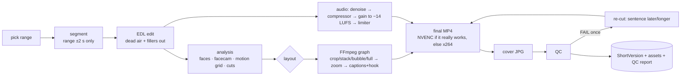

# Pipeline: Rendering & QC (Phase 5)

The `short.render` job turns a pick into a finished 1080×1920 MP4 + cover + QC report, stored as a new **ShortVersion** (versions never overwrite each other).

## Flow

| Module | Role |
|---|---|
| `pipeline/render/edl.py` | Keep speech; shrink silences > 0.55 s to 0.2 s; drop standalone "um/uh"; map source → output time |
| `pipeline/render/reframe.py` | MediaPipe face boxes (4 fps), 32×18 motion grid, scene cuts; facecam = small, steady, off-centre face; layout choice; crop path with dead zone, speed limit, jumps at cuts; motion ignores the facecam region |
| `pipeline/render/captions.py` | ASS generator, 5 styles as data (classic, word, box, karaoke, minimal), keyword colour, hook banner (3 s), caption coverage for QC |
| `pipeline/render/effects.py` | Zoom punch-ins on peaks (per-frame scale), iterative loudness targeting |
| `pipeline/render/compose.py` | Edit pass + final graph per layout, written to a file (`-/filter_complex`), encoder detection by a real test encode |
| `pipeline/render/cover.py` | Peak frame + hook text |
| `pipeline/render/qc.py` | Duration, LUFS (EBU R128), black/frozen picture, first frame, audio present, caption coverage → PASS/WARN/FAIL |
| `services/render.py` | Orchestration, versions, assets, auto re-cut |

**Layouts:** `auto` (stack when a facecam is found, full when people are on both sides, else crop), `crop`, `stack`, `bubble` (round cam over full-screen game), `full` (whole frame over a blurred copy). Asking for stack/bubble without a detectable cam falls back to crop.

**Extra sizes:** 4:5 and 1:1 rendered from the same plan (crop or full), with captions re-laid out for that canvas (libass stretches mismatched canvases).

## Findings while building (fixed)

- **Loudness:** loudnorm's dynamic mode undershot on short clips (QC caught −20.6 LUFS). Now: light compressor, static gain, −1 dBFS limiter, and the gain is re-measured *after* the limiter up to 3 times. Result on tests and real clips: −14 ±1.5 LUFS (typically −15.2…−15.4 for heavily dynamic speech).
- **EDL too aggressive:** cutting every pause > 0.35 s made speech choppy; dead air threshold is now 0.55 s.
- **NVENC:** listed by FFmpeg but this PC's NVIDIA driver is too old (needs ≥ 610). The encoder is chosen by a real test encode, so renders use x264 until the driver is updated, then NVENC automatically.
- **Facecam in the game crop (real stream):** the talking streamer's motion pulled the game crop onto the cam, duplicating the face. Motion now ignores the cam region.

## API & UI

`POST /shorts/{id}/render` · `POST /runs/{id}/render` (all picks) · `GET /shorts/{id}` (versions + QC) · `GET /render/options` (styles, layouts, sizes, encoder). WebSocket `short.updated`. Run page: render toolbar (style, layout, extra sizes, "Render N picks"), per-pick progress, player with cover poster, QC badge + reasons, MP4/4:5/1:1 downloads, render again.

## Verified

- 26 render tests: EDL, every caption style, colours, groups, zoom, loudness chain, facecam/layout decisions, tracking speed limit, graphs per layout; golden renders through API + worker (1080×1920, duration, −14 ±1.5 LUFS, no black, cover JPEG, re-render versions, 4:5 size, stack and bubble with a forced cam, run render, double-render refusal).
- Real: test stream picks rendered in parallel (18 s each, QC pass, playable in the browser); a real 1.5 h GTA stream pick: facecam detected automatically → stack layout, QC pass, 35–42 s per render.

## Not done yet (tracked)

- Overlay/clutter crop (D4): stream chat/alerts at the frame edge can end up in the game crop.
- Letterbox removal, dark-cam brightening, black-flash/freeze cover (D10), video-call grid detection: planned; QC flags such problems meanwhile.
- More caption styles (30 total), fonts shipped with the app (currently system fonts), music/meme/voice (Phase 8).
- Contact sheet of a whole run (D22).
