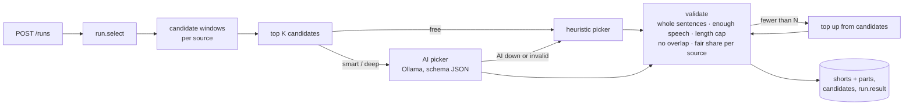

# Pipeline: Moment Selection (Phase 4)

A **run** = "make N Shorts from these analysed sources". The `run.select` job turns scored sentences into a short list of **picks** (Shorts with status `picked`), each with a range, hook, title, hashtags, keywords, credit, score and reason. Picks can be edited or dropped before rendering (Phase 5).

## Flow

| Module | Role |
|---|---|
| `pipeline/selection/windows.py` | Every sentence-aligned window of the run's **length preset** (short 15–60 s, medium 30–90 s with a 60 s target, long/whole scenes 45–170 s with a 100 s target, capped at 90/120/180 s after snapping); score = 0.65·peak heat + 0.35·mean, +6 payoff in back half, −8 peak at the very start (no premise), +3 per extra signal type, −10 mid-thought opener ("and…", "he…"), −20 under the preset's minimum speech (12/20/30 s), −8·|length − target|/target for medium/long. Greedy non-overlapping top K. Flat windows (no peak) score 0 |
| `pipeline/selection/heuristic.py` | "No AI" mode: best candidates, a fair share per source (max(2, ⌈N / sources⌉), so one long video can give all N, up to 50), near-duplicate texts skipped (Jaccard > 0.5), hook/title/hashtags from keywords and creator |
| `pipeline/selection/ai_picker.py` | AI chooses candidate **ids** only; it may move start/end by ≤ 10 s; unknown ids ignored; a score of 0 falls back to the signal score |
| `pipeline/selection/validate.py` | Snap to whole sentences; reject too short/long, overlapping, over the per-source cap; clean hook (≤ 6 words, caps), title (≤ 70), hashtags (3–5 + #shorts), keywords (≤ 3) |
| `pipeline/selection/callbacks.py` | Claim ("I bet…", "watch me…") 1 min–3 h before a hot payoff sharing a noun → listed on the run page |
| `pipeline/selection/evaluate.py` | Eval harness: precision/recall of picks vs labelled moments (IoU ≥ 0.3) |
| `ai/ollama.py` | Ollama `/api/chat` with `format` = JSON schema, `think: false`, one repair round on invalid JSON, readable errors (not running, model missing) |
| `ai/prompts.py` | Fixed system prompt with the selection rules; candidates in the user message; transcript wrapped in `<transcript>` and declared as data |
| `services/runs.py` | Orchestration, used-range exclusion (picks not rejected/dropped), fallback/top-up, persistence |
| `services/preview.py` | 4-frame preview strip per pick from the proxy or original video |

**Modes** (Create → How to pick shows the first three):

- `smart`: the AI reads the candidate windows of the chosen length (head…tail) and picks the clips most likely to go viral.
- `deep`: whole **action scenes**, whatever their length (`pipeline/selection/scenes.py`). From the picture analysis (per-second motion, scene cuts) and the loudness curve, a scene is a stretch where the picture moves much more than usual for this video (motion against a 3-minute rolling baseline and against the whole video, lifted by loud sound). Lulls under 5 s do not end a scene; 3 s of build-up and 2 s of tail are kept; boundaries snap to a scene cut within 3 s; scenes under 12 s are dropped and over 10 min are split at their calmest second. Score = mean and 90th-percentile intensity, a slowly growing length bonus, and a bonus for impact / loud / chat marks inside. The AI (when on) chooses among the best scenes and writes the texts but cannot trim them. Needs “Analyse the picture”; without it the run fails with that hint.
- `custom`: exactly the typed range (`HH:MM:SS`, `MM:SS` or seconds, at most 20 minutes), one Short per selected source, not snapped to speech; works on silent footage too.
- `free` (no AI) and `whole` (each short uploaded clip as one Short) stay in the API for older runs and scripts.

**Fail-safe:** if the AI is unreachable, times out or returns invalid JSON twice, the run uses the heuristic and says so in `result.warnings`. If the AI returns fewer usable picks than asked, the rest are filled by signal score (also stated).

## Settings

| Env var | Default | |
|---|---|---|
| `CF_AI_PROVIDER` | `ollama` | `ollama` or `none` |
| `CF_OLLAMA_URL` | `http://127.0.0.1:11434` | |
| `CF_OLLAMA_MODEL` | `qwen3.5:4b` | any pulled model; a run can override it |
| `CF_AI_TIMEOUT_S` | 300 | per AI request |
| `CF_CANDIDATES_K` | 30 | candidates shown to the AI (smart) |

## API

| Method | Path | |
|---|---|---|
| POST | `/api/v1/runs` | `{source_ids, n, pick_mode, topic?, ai_model?}` |
| GET | `/api/v1/runs`, `/api/v1/runs/{id}` | run + picks (with parts, preview flag) + candidates |
| PATCH | `/api/v1/shorts/{id}` | hook, title, hashtags, keywords, start_s/end_s (snapped) — only while `picked` |
| DELETE | `/api/v1/shorts/{id}` | drop (soft; its range becomes free again) |
| GET | `/api/v1/shorts/{id}/preview.jpg` | 4-frame strip |
| GET | `/api/v1/ai/status` | provider, model, reachable, installed models |

WebSocket: `run.updated`.

## Verified

- 183 backend + 21 frontend tests (selection units, Ollama client against a mock server, runs end to end).
- Real end to end on this PC: a 100 s spoken test stream (Windows TTS) → upload → Whisper on CUDA → HEAT peaks at the bridge jump (≈45 s) and the race win (≈89 s) → Smart run with **qwen3.5:4b on Ollama**: both moments picked (36–54 s, 81–99 s) with fitting hooks, 42 s, 956 tokens, no warnings. "Watch" opens the source at the pick's start.
- Not measured: pick quality on real long streams (no labelled set yet; the eval harness is ready for one). Claude provider is not implemented yet (needs an API key).
