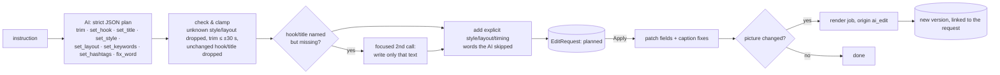

# Studio, review, export & settings (Phase 6)

Phase 6 turns the pipeline into an app you can use end to end in the browser:
paste a link → pick moments → render → **review** → **edit in the studio** → **export**.

## Screens

| Route | What it does |
|---|---|
| `/welcome` | First-run wizard: system check → AI choice (Ollama or none, model) → first source. Shown once (`onboarded` setting), re-openable from Settings. |
| `/` | Dashboard: counts (sources ready, picks not rendered, to review, approved, failed QC) linking to filtered lists; system; jobs. |
| `/shorts` | Library: all Shorts, tabs by status, QC filter, search (hook/title/credit), keyset paging, bulk approve/reject. |
| `/review` | Review queue: one Short at a time, autoplay. Keys **A** approve, **R** reject (optional reason, Enter), **J/K** next/previous, **E** open studio. The sidebar shows how many are waiting. |
| `/shorts/:id` | Studio: player + version list (every render is kept), approve/reject/re-open, export ZIP, and five tabs (below). |
| `/settings` | UI-editable settings by section (AI, analysis, rendering, downloading), unsaved-changes bar, per-field "use default". |

### Studio tabs

The **Customise** tab (default) is the template and look editor; see [templates.md](templates.md). The tabs below remain for texts, timing and fixes.


| Tab | Change | Needs a new render? |
|---|---|---|
| Post | title, hashtags (saved immediately); hook, highlighted words | only hook/highlights (a "Render now" hint appears) |
| Trim | start/end by clicking sentences (cuts snap to sentence edges, max 3 min) | yes ("Save and render") |
| Captions | fix a word's spelling or hide it; audio untouched | yes |
| AI edit | describe the change in words → plan → Apply/Discard | when the picture changes |

A studio render is recorded with origin `manual_edit`, an AI edit with `ai_edit`, so the version list says where each version came from.

## Caption fixes

Each transcript word has a stable key: its start time in the source, 2 decimals (`"611.20"`).
Fixes are a map `key → new text` (`""` hides the word) stored on the version
(`short_versions.caption_overrides`). They only change the captions, never the audio cut.
A re-render without new fixes keeps the previous version's fixes.

## AI edit



- Nothing changes until **Apply**; every request (including failed or discarded ones) is kept in the history.
- Without an AI provider a rule parser handles common phrases: `hook: TEXT`, `title: TEXT`, `box style`,
  `stack layout`, `start 2s later`, `end 3s earlier`, `shorter`, `fix Stranger to Ranger`.
- **Finding:** the local 4B model handled single requests well but, on "punchier hook *and* karaoke style",
  sometimes did only one half, misread "hook" as a trim, or returned the same hook. Fixed with prompt rules
  and examples, the focused second call for hook/title, and merging explicit style/layout/timing words.
  Verified live: plan = karaoke + "LAST PLACE TO FIRST" → applied → v2 rendered, QC pass.

## Review states

```
picked → rendering → review → approved
                  ↘ failed      ↘ rejected (optional reason)
approved / rejected → re-open → review (or picked if never rendered)
```
Approving needs a rendered version. Edits are allowed in every state except `rendering` and `dropped`.

## Export

- `GET /shorts/{id}/export.zip` → `short.mp4`, `cover.jpg`, extra sizes, `post.txt`
  (title, caption, hashtags, credit with a link to the original **at the right second** for YouTube/Twitch).
- `GET /runs/{id}/export.zip?only=approved|rendered` → one folder per Short + `shorts.csv` for bulk schedulers.
- ZIPs are built in `data/tmp/exports` and deleted right after sending; videos are stored, not re-compressed.

## Settings layered over `.env`

`services/settings_store.py`: a whitelist of fields (AI, analysis, rendering defaults, download options,
`auto_render`, `onboarded`) can be saved from the UI into the `settings` table and are validated with the
same pydantic rules as `.env`. Services call `settings_store.effective()`; the API and each worker cache it
for 5 s, so a change reaches running workers within seconds. Paths, ports, the database URL and secrets
are never editable from the app. `auto_render` queues renders as soon as a run picks its moments.

## API

| Method & path | Purpose |
|---|---|
| `GET /shorts?status=&run_id=&source_id=&qc=&q=&cursor=&limit=` | library page |
| `POST /shorts/{id}/review` · `POST /shorts/review` | approve/reject/re-open one or many |
| `GET /shorts/{id}/words` | words in range + current fixes + sentences around it |
| `POST /shorts/{id}/ai-edit` · `GET /shorts/{id}/edits` · `POST /edits/{id}/apply` | AI edit plan, history, apply |
| `POST /shorts/{id}/render` | now also takes `caption_overrides` and `origin: manual_edit` |
| `GET /shorts/{id}/export.zip` · `GET /runs/{id}/export.zip` | exports |
| `GET /stats` | dashboard counts |
| `GET /settings` · `PATCH /settings` | editable settings (`values`, `reset`) |

## Tests

Backend `tests/test_studio_flow.py` (16): settings validation/all-or-nothing/reset and effect on runs and
render defaults, auto-render, library filters/search/paging, review rules and bulk, stats, export contents
and temp cleanup, platform timestamp links, words view, rule-based and provider AI edits (plan, sanitise,
apply, history, focused rewrite, merge), and a real FFmpeg render proving caption fixes reach the video and
survive an AI-edit re-render. Frontend `features/shorts/shorts.test.tsx` (6): library tabs + bulk approve,
review hotkeys + reject reason + empty state, studio AI-edit plan/apply and post save, settings save/reset.

## Not done yet

- Playwright end-to-end tests (roadmap exit criterion) — the flows were checked by hand in the browser.
- "Dry run" in the create wizard, run-level contact sheet, manual crop position, preview of a version
  before making it active (all versions are viewable, the newest is always active).
- Other UI languages (strings are all in `locales/en.json`).
